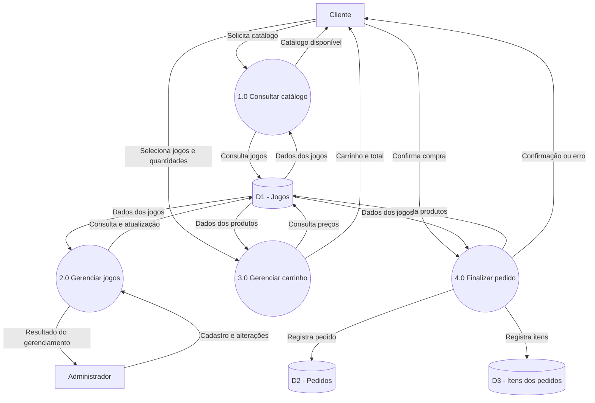

# DFD Nivel 0 - Chapa Games

## Descrição

O Diagrama de Fluxo de Dados (DFD) nível 0 apresenta os principais processos do sistema Chapa Games, demonstrando a comunicação entre os usuários, os processos e os depósitos de dados.

## Diagrama

## Dicionário de Dados

O dicionário de dados apresenta os principais elementos utilizados pelo sistema.

| Item | Campos principais | Tipo |
|---|---|---|
| Jogo | id, nome, preço, disponibilidade | Inteiro, texto, decimal e booleano |
| Catálogo | Lista de jogos disponíveis | Coleção de jogos |
| Carrinho | id, lista de itens, valor total | Inteiro, coleção e decimal |
| ItemCarrinho | id_jogo, quantidade, preço | Inteiro e decimal |
| Pedido | id_pedido, data, valor_total, status | Inteiro, data, decimal e texto |
| ItemPedido | id_jogo, quantidade, preço_unitário | Inteiro e decimal |
| DadosPedido | Itens, quantidades e informações da compra | Objeto JSON |
| RespostaPedido | sucesso, mensagem e dados do pedido | Booleano, texto e objeto JSON |

## Considerações

O DFD e o dicionário de dados ajudam a documentar o funcionamento do Chapa Games, facilitando a compreensão dos processos e a organização das informações utilizadas pelo sistema.

Os campos e processos devem ser conferidos com a implementação efetiva do projeto.
